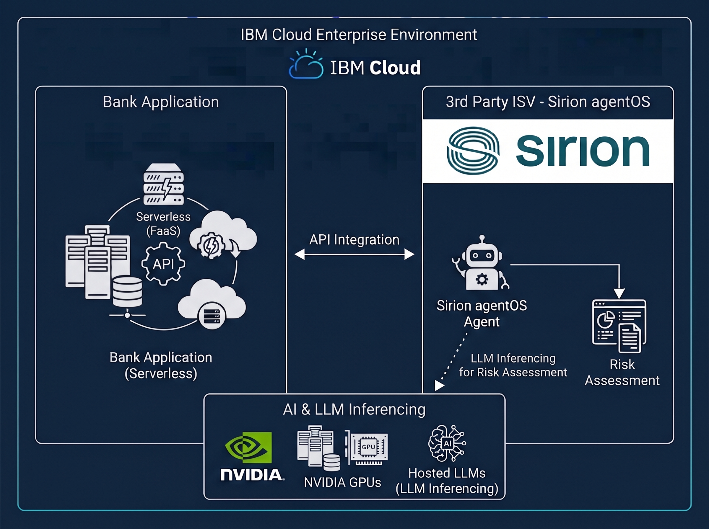

# Architecting Regulated AI on IBM Cloud: 

## Powered by - Sirion agentOS and nVIDIA

### TechXchange 2026

> **Welcome!** This hands-on lab walks you through building a Multi-Agent work flow for a Trade Finance solution on Sirion Agent OS hosted on IBM Cloud, from building Agents to deploying a fully integrated contract lifecycle management workflow.

---

## What You Will Build

You will buid an end to end Enterprise Agentic AI solution for an use case in Contract Lifecycle Management in Trade Finance with Agents created on Sirion agentOS and Banking application deployed on Severless Code Engine on IBM Cloud.

The Agent will inference LLMs hosted on NVIDIA GPUs within the IBM Cloud infrastructure.

By the end of these labs you will have:

- ✅ Agentic AI Workflow for Contract Lifecycle Management Solution
- ✅ Inferencing LLMs hosted on IBM Enterprise nVIDIA GPUs within IBM Cloud infrastructure
- ✅ Deploy Serverless Applications integrating with Risk Analyser Agent running agentOS platform
- ✅ Understand Industry Security and Compliance on IBM Cloud

---

## Lab Structure

| Lab | Topic | Duration |
|-----|-------|----------|
| Section 1 | Introduction | 10 min |
| Section 2 | Building Multi-Agent Workflow on Sirion Agent OS | 30 min |
| Section 3 | Deploying application on serverless code engine | 30 min |
| Section 4 | Understanding Security and Compliance | 10 min |
| Section 5 | Questions | 10 min |

**Total estimated time:** 90 minutes

---

## How to Use This Guide

Navigate using the **sidebar** on the left or the **arrows** at the bottom of each page. Use the **search bar** (top of sidebar) to jump to any topic.

> 💡 All commands in this guide can be copied with a single click using the **Copy** button that appears on hover.

---

## Getting Help

Lab Facilitators

| Name | Details |
|---------|---------|
| Pradeep Kadiyala | Sr. Solutions Architect - IBM FS Cloud |
| Drew Thorstensen | Distinguished Engineer - IBM Cloud - Compute & AI Infrastructure |

---

*Start with [Prerequisites →](overview/prerequisites.md)*
