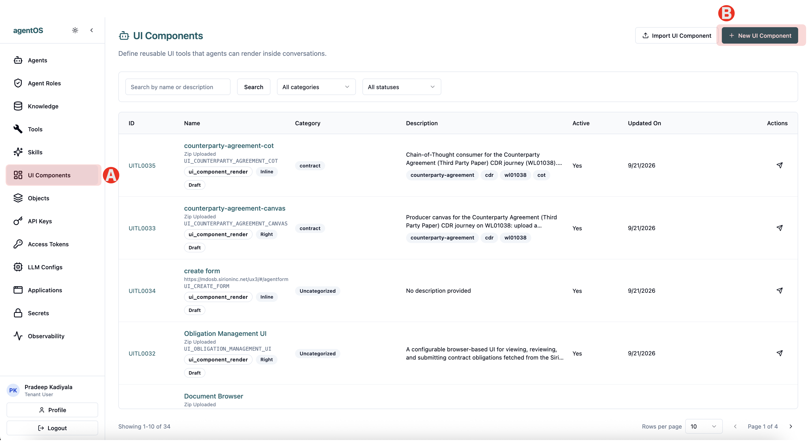
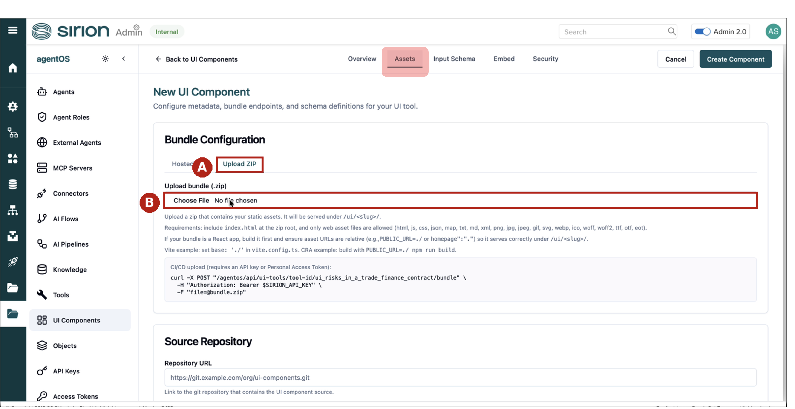
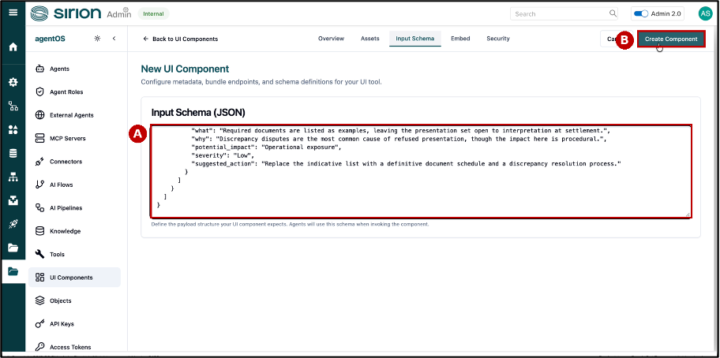
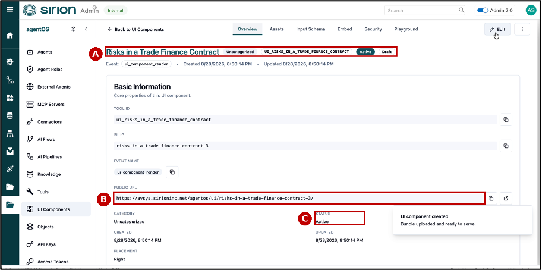
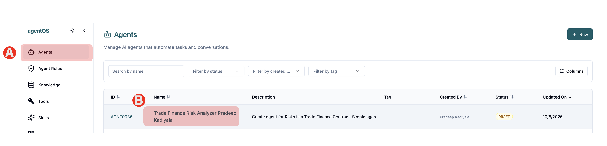
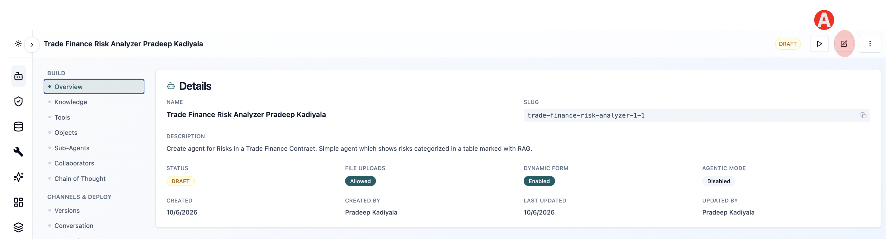
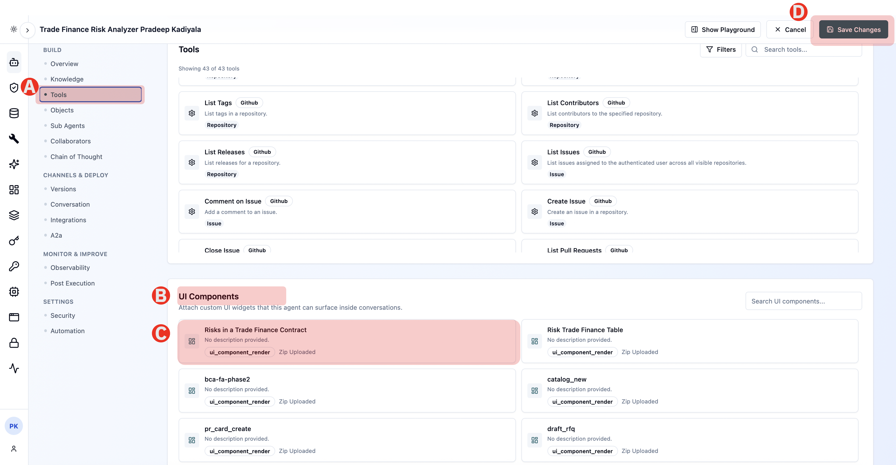
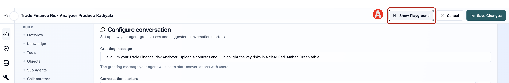
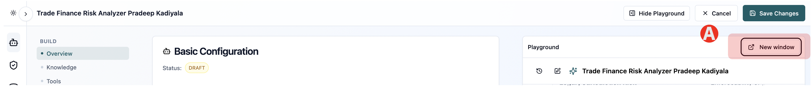
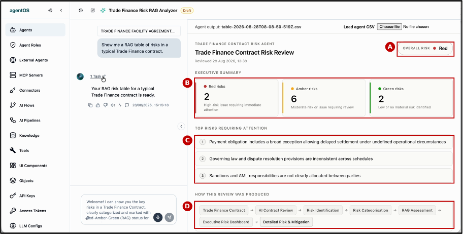

# 1.4 Implement Deterministic UI

You can give your agent a deterministic interface, but the component it renders has to exist in the environment before it can be used. 

A UI component is registered once, from the main navigation, and every agent in the environment can then render it. 

Steps to create Deterministic UI

## Step 1 - Create UI Component



(A) In the main navigation, click UI Components

(B) Click New UI Component

## Step 2 - Upload UI Zip file



Open the Assets tab. 

(A) Under Bundle Configuration, select Upload ZIP 

(B) Click Choose File, and select the component bundle supplied with this lab — Risks-TradeFinance-Contract-Bundle.zip

The zip must contain index.html at its root and only web asset files

> The UI Component Zip file is provided in the Pre-requisites. You can also download from here <a href="lab1/files/RisksinTradeFinanceContract-Bundle.zip" download="Risks-Trade-Finance-Contract-UI-Component.zip">Download Risks-Trade-Finance-Contract-UI-Component.zip</a>

## Step 3 - Create Schema



Open the Input Schema tab 

(A) Copy and Paste the JSON schema that defines the payload the component expects. 

```json
{
  "$schema": "http://json-schema.org/draft-07/schema#",
  "title": "Risks in a Trade Finance Contract — UI Input",

  "description": "The single JSON object the Trade Finance Contract Risk Agent emits after reviewing an uploaded contract. The UI component renders it as an executive summary, a top-risks list, a RAG risk table, and a per-row drill-down. Emit this object and nothing else: no markdown, no CSV, no prose report, no commentary on how the review was produced. INVARIANTS THE AGENT MUST HOLD: (1) impact and rag always agree — High with Red, Medium with Amber, Low with Green; (2) severity always equals impact; (3) every Red and Amber row carries the full drill-down (what, why, potential_impact, severity, suggested_action); (4) high_count, moderate_count and low_count equal the number of Red, Amber and Green rows respectively; (5) overall_contract_risk is Red if any row is Red, otherwise Amber if any row is Amber, otherwise Green; (6) rag and overall_contract_risk are plain words, never emoji — the component supplies its own indicators; (7) rows are ordered Red first, then Amber, then Green. Every row must trace to a real clause in the uploaded contract: never fabricate a reference. Prioritise material findings rather than listing exhaustively, and omit any category that holds no material risk instead of inventing a row to fill it.",

  "type": "object",
  "additionalProperties": false,
  "required": ["overall_contract_risk", "high_count", "moderate_count", "low_count", "top_risks", "risks"],

  "properties": {

    "contract_name": {
      "type": "string",
      "minLength": 1,
      "description": "Optional. Contract title shown in the component header. If omitted the component shows 'Contract Risk Review'.",
      "examples": ["Trade Finance Facility Agreement — Acme Trading Ltd"]
    },

    "reviewed_at": {
      "type": "string",
      "format": "date-time",
      "description": "Optional. ISO 8601 review timestamp. If omitted the component hides the reviewed-at line.",
      "examples": ["2026-08-28T13:28:35Z"]
    },

    "overall_contract_risk": {
      "type": "string",
      "enum": ["Red", "Amber", "Green"],
      "description": "Executive summary verdict, as a plain word with no emoji. Red if any row is Red; otherwise Amber if any row is Amber; otherwise Green. Send Green together with an empty risks array and an empty top_risks array when the contract is clean — the component then states plainly that no material risks were identified."
    },

    "high_count": {
      "type": "integer",
      "minimum": 0,
      "description": "Number of High / Red findings. Must equal the number of rows whose rag is 'Red'. The component displays counts derived from the rows themselves, so a value that disagrees with the rows is a payload defect, not a display option."
    },

    "moderate_count": {
      "type": "integer",
      "minimum": 0,
      "description": "Number of Medium / Amber findings. Must equal the number of rows whose rag is 'Amber'."
    },

    "low_count": {
      "type": "integer",
      "minimum": 0,
      "description": "Number of Low / Green findings. Must equal the number of rows whose rag is 'Green'."
    },

    "top_risks": {
      "type": "array",
      "minItems": 0,
      "maxItems": 3,
      "default": [],
      "description": "Top risks requiring attention, most severe first — short business headlines, each a complete sentence. Send an empty array only when the contract is clean. If omitted or empty while rows exist, the component derives the list from the Red and Amber rows.",
      "items": {
        "type": "string",
        "minLength": 1
      }
    },

    "risks": {
      "type": "array",
      "default": [],
      "description": "Risk table rows, ordered by severity — Red first, then Amber, then Green — which is also the order the component applies by default. Group related findings into one row; never emit duplicates. Red and Amber rows must include the five drill-down fields; Green rows should include them wherever there is something useful to expand.",
      "items": {
        "type": "object",
        "additionalProperties": false,
        "required": ["risk_category", "risk_issue", "contract_reference", "impact", "rag"],

        "properties": {

          "risk_category": {
            "type": "string",
            "description": "Risk Category column. One of the twelve fixed categories, used exactly as written here — no 'Risk' suffix.",
            "enum": [
              "Financial",
              "Payment & Settlement",
              "Counterparty",
              "Credit",
              "Compliance & Regulatory",
              "Operational",
              "Legal & Contractual",
              "Collateral / Security",
              "Default & Termination",
              "Country / Jurisdiction",
              "Sanctions / AML",
              "Documentation"
            ]
          },

          "risk_issue": {
            "type": "string",
            "minLength": 1,
            "description": "Risk / Issue column. A single complete sentence in business language stating the issue. This is the table cell, not the drill-down.",
            "examples": ["The payment obligation is subject to a broad exception permitting delayed settlement in undefined operational circumstances."]
          },

          "contract_reference": {
            "type": "string",
            "minLength": 1,
            "description": "Contract Reference column. The clause or section as it appears in the uploaded contract, formatted consistently across every row. Must exist in the document — never fabricate one.",
            "examples": ["Clause 8.2", "Clause 18 and Schedule 3, Paragraph 2"]
          },

          "impact": {
            "type": "string",
            "enum": ["High", "Medium", "Low"],
            "description": "Impact column. The bare word only — no trailing description and no em-dash clause. Must agree with rag: High with Red, Medium with Amber, Low with Green."
          },

          "rag": {
            "type": "string",
            "enum": ["Red", "Amber", "Green"],
            "description": "RAG column, as a plain word with no emoji. Rate on business significance, not on whether the wording is unusual: Red is a material issue needing immediate attention, Amber a meaningful concern to review, Green no material concern. Must agree with impact."
          },

          "what": {
            "type": "string",
            "minLength": 1,
            "description": "Drill-down — 'What is the risk?'. One or two concise sentences. Required on Red and Amber rows."
          },

          "why": {
            "type": "string",
            "minLength": 1,
            "description": "Drill-down — 'Why does it matter?'. The business consequence, not a restatement of the clause. Required on Red and Amber rows."
          },

          "potential_impact": {
            "type": "string",
            "minLength": 1,
            "description": "Drill-down — 'Potential Impact'. A short exposure label naming the affected dimensions. Required on Red and Amber rows.",
            "examples": ["Financial and operational exposure", "Compliance and regulatory exposure"]
          },

          "severity": {
            "type": "string",
            "enum": ["High", "Medium", "Low"],
            "description": "Drill-down — 'Severity'. Must equal impact. Required on Red and Amber rows."
          },

          "suggested_action": {
            "type": "string",
            "minLength": 1,
            "description": "Drill-down — 'Suggested Action'. One practical next step, phrased as guidance rather than definitive legal advice. Required on Red and Amber rows. Green rows may state 'No action required.'; if omitted the component shows that text."
          }
        }
      }
    }
  },

  "examples": [
    {
      "contract_name": "Trade Finance Facility Agreement — Acme Trading Ltd",
      "reviewed_at": "2026-08-28T13:28:35Z",
      "overall_contract_risk": "Red",
      "high_count": 1,
      "moderate_count": 1,
      "low_count": 1,
      "top_risks": [
        "Payment may be delayed indefinitely under a broadly drafted operational exception.",
        "Sanctions and anti-money-laundering responsibilities are not allocated between the parties."
      ],
      "risks": [
        {
          "risk_category": "Payment & Settlement",
          "risk_issue": "The payment obligation is subject to a broad exception permitting delayed settlement in undefined operational circumstances.",
          "contract_reference": "Clause 8.2",
          "impact": "High",
          "rag": "Red",
          "what": "Settlement may be postponed where the payer cites operational circumstances, a term the agreement leaves undefined and subject to no outside limit.",
          "why": "The company cannot forecast when funds will arrive, and has no contractual lever to compel payment while the exception is invoked.",
          "potential_impact": "Financial and operational exposure",
          "severity": "High",
          "suggested_action": "Define the qualifying circumstances exhaustively and impose an outside date beyond which settlement falls due regardless."
        },
        {
          "risk_category": "Sanctions / AML",
          "risk_issue": "Sanctions and anti-money-laundering responsibilities are not allocated between the parties.",
          "contract_reference": "Clause 12",
          "impact": "Medium",
          "rag": "Amber",
          "what": "The agreement requires compliance with applicable law but does not state which party screens counterparties, vessels, or end destinations.",
          "why": "Unallocated screening duties leave gaps that regulators treat as the financing party's own control failure.",
          "potential_impact": "Compliance and regulatory exposure",
          "severity": "Medium",
          "suggested_action": "Assign screening and escalation duties expressly, and add a right to suspend or terminate on a sanctions event."
        },
        {
          "risk_category": "Documentation",
          "risk_issue": "The schedule of required shipping and trade documents is indicative rather than definitive.",
          "contract_reference": "Clause 6",
          "impact": "Low",
          "rag": "Green",
          "what": "Required documents are listed as examples, leaving the presentation set open to interpretation at settlement.",
          "why": "Discrepancy disputes are the most common cause of refused presentation, though the impact here is procedural.",
          "potential_impact": "Operational exposure",
          "severity": "Low",
          "suggested_action": "Replace the indicative list with a definitive document schedule and a discrepancy resolution process."
        }
      ]
    }
  ]
}
```

This schema is the contract between the agent and the component

(B) Click Create Component 

Sirion agentOS uploads the bundle and confirms UI component created — Bundle uploaded and ready to serve.

## Step 4 - Review the UI Component



(A) The component name, its tool ID and its state.

(B) Public URL — where the bundle is served from. Agents reach the component through this address.

(C) Status — Active. The component is now available to every agent in the environment, including the one you built.

## Step 5 - Return to the Agent



(A) Click on "Agents" on the left menu bar

(B) Click on your previously created Agent

## Step 6 - Edit the Agent



(A) Click on Edit Agent button on top right corner

## Step 7 - Add newly created UI Component



(A) Goto tools section by clicking on Tools

(B) Below Tools you will find UI Components. Scroll down if needed

(C) Find and select the newly created UI Component "Risks in a Trade Finance Contract"

(D) Save the updates to the Agent

## Step 8 - Click Show Playground



(A) Click Show Playground in the top right of the agent

## Step 9 - Run the Agent

 

(A) Click on New Window button on top right corner of the playground



Now ask the agent for the same analysis in its dashboard view

```text
Show me a RAG table of risks in a typical Trade Finance contract.
```

The agent renders the Risks in a Trade Finance Contract UI component — the same findings, presented as an executive dashboard

---

### Watch the walkthrough

<video controls width="100%">
  <source src="lab1/videos/1_4_UI.mp4" type="video/mp4">
  Your browser does not support the video tag.
</video>

---

## ✅ Checkpoint

- [ ] Create Deterministic UI Component
- [ ] Test the UI Component against Agent

*Next: [1.4 Generate Agent API Key  →](lab1/05-api.md)*

