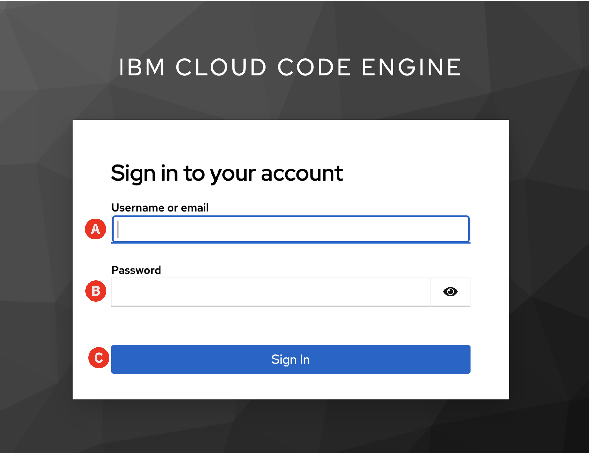
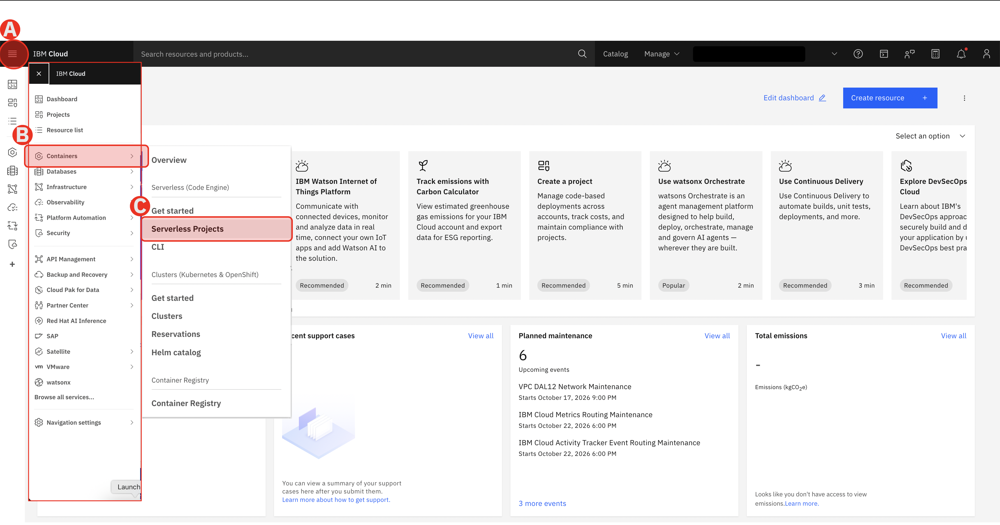
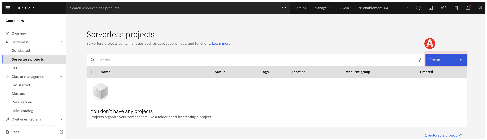
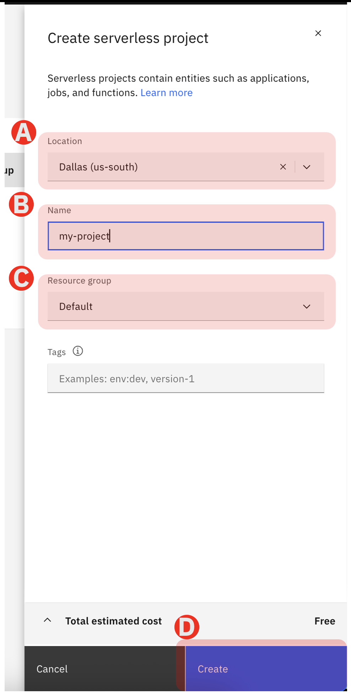
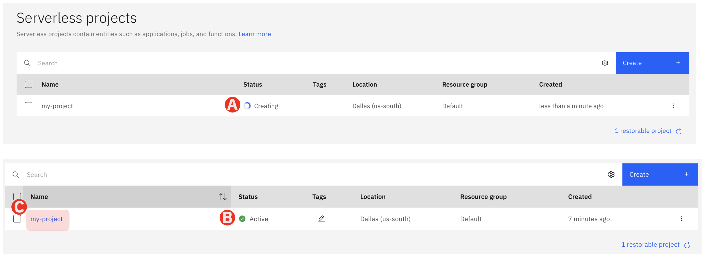
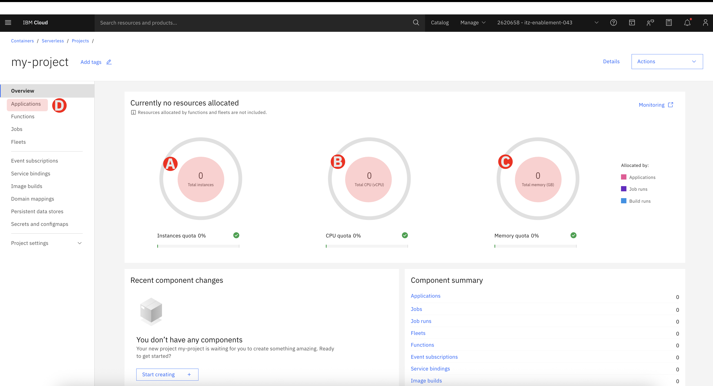

# 2.1 Deploy Agentic    Application on IBM Cloud

In this section you will deploy an enterprise-hosted Agentic Application with Chatbot UI. The application will be integrated with Agent you created on Sirion agentOS in previous step

Before you start this section, make sure you have the following

- [x] Sirion agentOS Agent Slug value
- [x] Sirion agentOS API Key

> If you dont have the Agent Slug value and API Key, you can retrive by following the instruction in the previous section [Generate Agent API Key](../lab1/05-api.md)

## Create Project on Serverless Code Engine

## Step 1 - Login to IBM Cloud

Once you registeer to this lab session you will be given the lab account url https://cloud.ibm.com/authorize/lab1623txuser1201.

- Use your (A) username and (B) password provided to you in a handout to login to IBM Cloud account

- (C) Click "Sign In" button to login to IBM Cloud

> User Name and password to login to IBM Cloud account will be provided in the handout document during the lab session. You will find the credentials under IBM Cloud Code Engine Platform > Credentials

## Step 2 - Open Serverless Projects in IBM Cloud Dashboard

After you successfully login, navigate to Serverless project on the Main Menu

(A) Click the hamburger icon to expand the menu

(B) Navigate to "Containers"

(C) Select Serverless Projects

## Step 3 - List Serverless Projects

A Serverless Project dashboard is displayed. Serverless projects are containerized applications, jobs, functions that run securely. 

The resources are allocated and de-allocated on-demand and scale from 0 to n instances and scale down to 0 when its not being used.

This lab uses it to showcase single page applications or client applications that run on-demand in a secure environment

(A) Click "Create" button to create project

## Step 4 - Configure and Create the project

Fill in the project configurations

> Make sure you provide unique name while creating the project. You can use your name and your company name as a unique combination.

(A) Select the location to Dallas (us-south). While creating a project you can choose which region you want your applications to run. For this lab use only Dallas (us-south)

(B) Provide the name of the project under the Name. Keep it unique so it doesnt conflict with others

(C) The resource group should be default. Resource Groups are used for grouping the cloud resources for various purposes such as authorizations and security and compliance audits.

(D) Click "Create" button. This will take around less than a minute to create the project environment in the given region

## Step 5 - Check the Project Status

Creating the project in the given region will take around less than a minute. Make sure the status of the project to change from (A) creating to (B) Active

(C) Click on the project once the Status turns Active

## Step 6 - Project Dashboard

The project dashoboard gives the overview of the resource consumption. From here you can create and deploy application, serverless functions, jobs and even run a fleet of high performance computes and GPUs for process intesive jobs.

In the dashboard you will see

(A) Number of instances (Applications, jobs etc) are running

(B) Total vCPUs utilized

(C) Total memory utilization

(D) Click on Application on the left side menu to create Agentic AI Application

---

## ✅ Checkpoint

- [ ] Create Project under Serverless Projects
- [ ] Review the Project Dashboard

*Next: [2.2 Deploy Agentic AI Application  →](lab2/02-create-run-app.md)*

