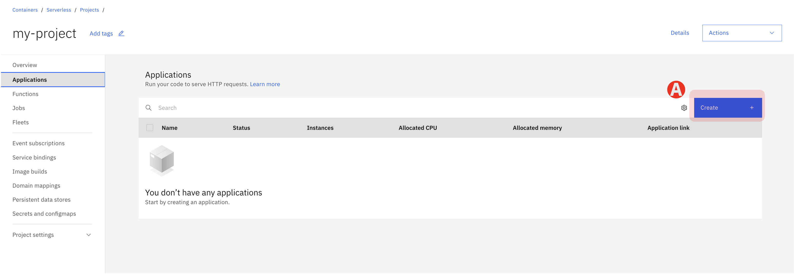
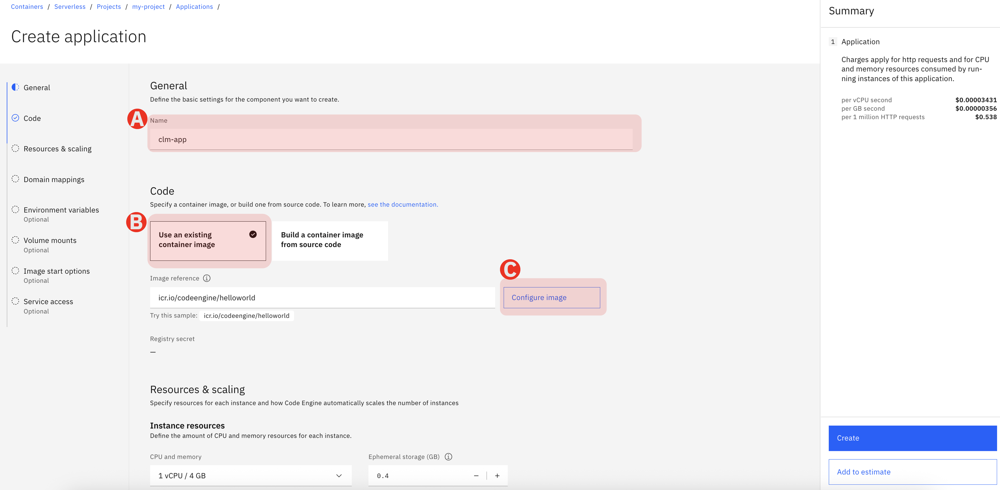
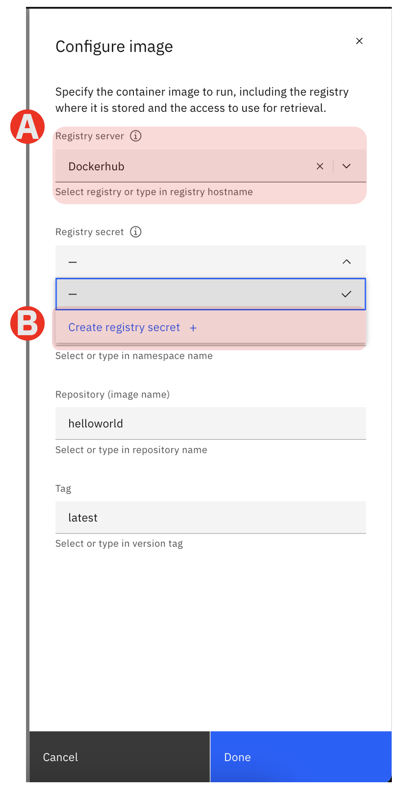
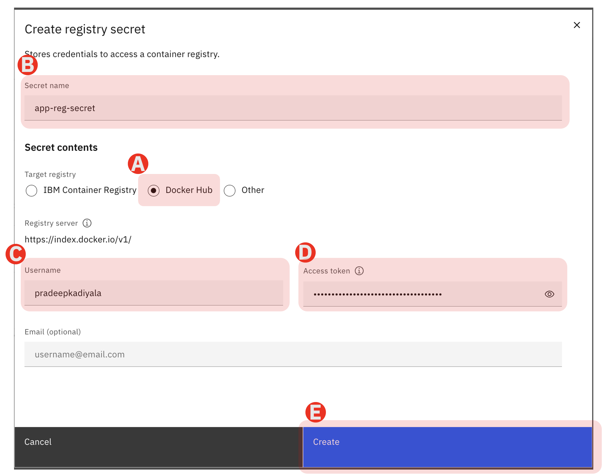
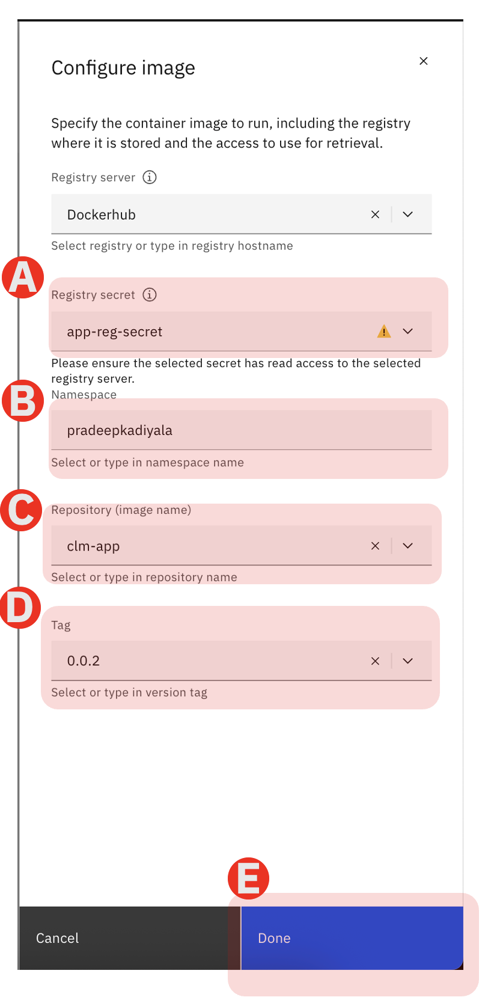
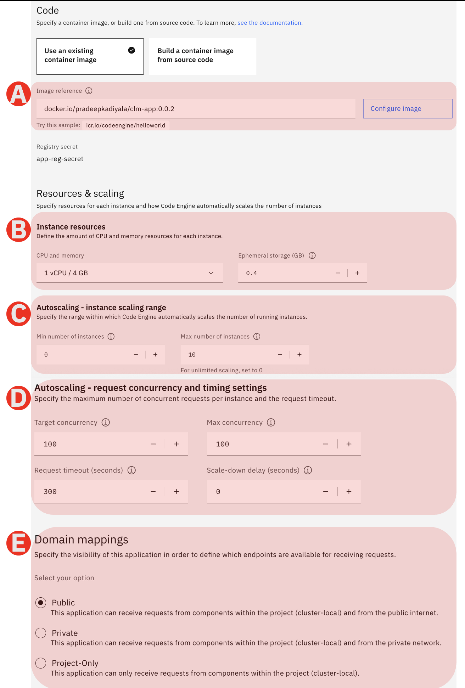
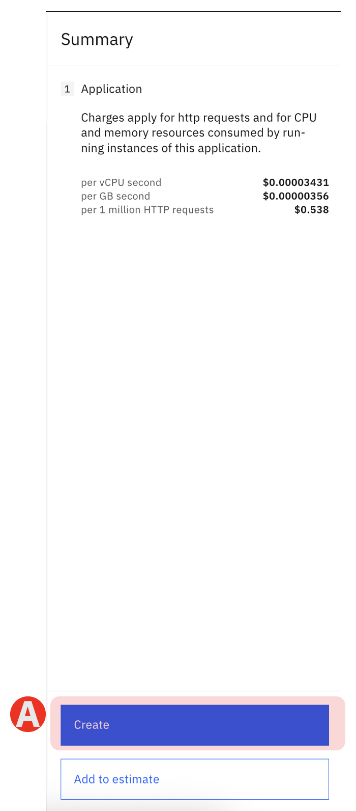
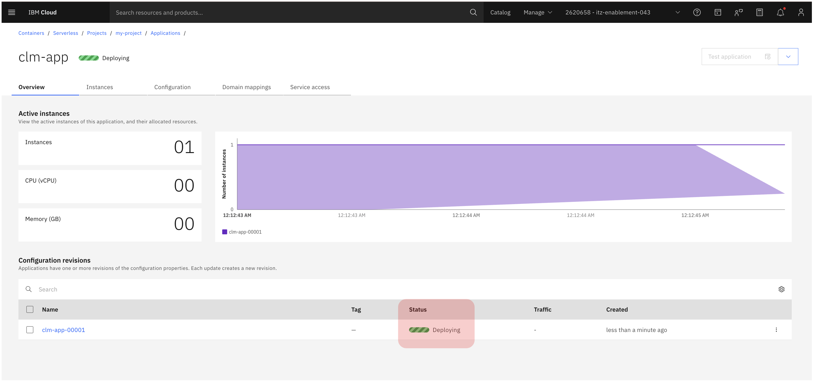
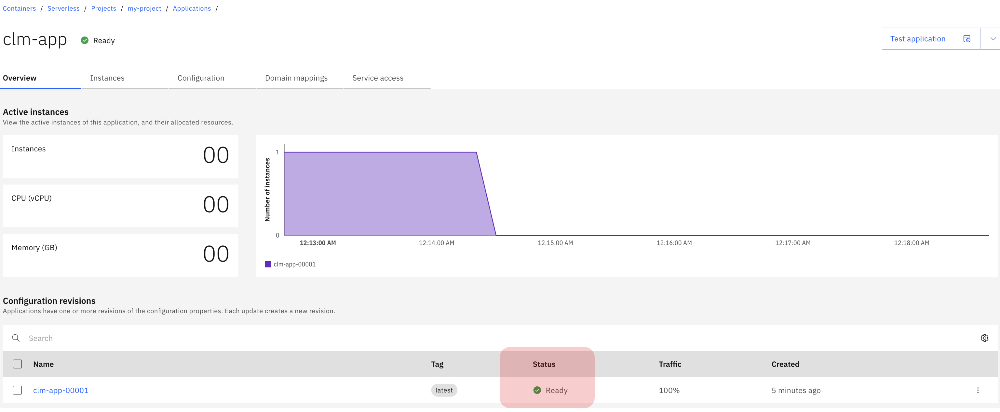
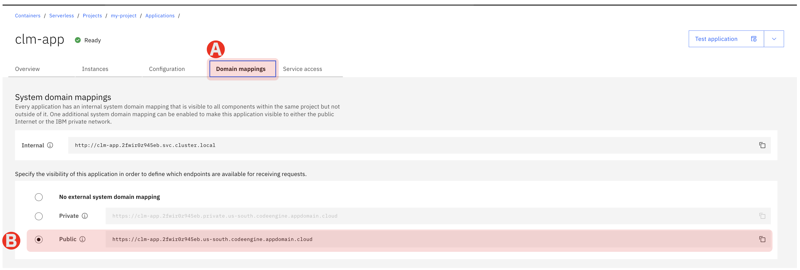

# 2.2 Deploy Agentic AI Application

This is a client application that is integrated to the Agent that you created on Sirion agentOS. 
This application is already packaged as an image in container registry
The application will be deployed on the serverless project platform

## Step - 1: Create Application



(A) Click "Create" button to create the application

## Step - 2: Configure the Application

You will configure the application with pre-built apllication image as below.
The application is already pre-built and the application image is in the dockerhub container registry.



(A) Give a name to the application you are deploying

(B) Select "Use an existing container image". 

> Note: You can also deploy a containerized application from a github repo using the other option "Build a container image from source code repo". But for this lab we will use existing container image from the container registry

(C) Click on "Configure image" button

## Step - 3: Configure the Image

You will configure the image from public Docker hub container registry. You are provided with the docker hub credentials with READ-ONLY access to the application image in pre-requisites.

> Note: A full Enterprise IBM Cloud account will allow you to have the application images in private container registry. For this lab we will be using docker hub.



(A) Select the Registry server as Dockerhub. In the dropdown its the last option

(B) Select the drop down under "Registry secret" and click "Create registry secret +". 

> Dockerhub credential are secured in **Secrets Manager**. These credentials are used to pull the application image from docker hub.


## Step - 4: Create registry secret

A pop window will open when you click on "Create registry secret +". Here you will provide the Dockerhub credentials to get access to application image



(A) First select "Docker Hub" under Target registry

(B) Give a name to the secrets so you dont reveal the actual secrets in Secrets Manager

(C) Provide the username. This will provided to you in the printed "Lab Requirements" document when you attend the lab

(D) Provide the "Access token". This will be provided to you in the printed "Lab Requirements" document when you attend the lab

> If you dont find the dockerhub API Token in pre-requisites you can copy it from here

```text
dckr_pat_F0alXKlSSN82I8dyMd7RtVBiP3w
```

(E) Click "Create" button

## Step - 5: Configure registry image with version tag

After you create the secret you will have access to the container image registry where you can find your images with their versions. Select them as below



(A) Once you create secret with Dockerhub credentials you will see it under Registry secret. Ignore the warning icon if you see it

(B) Provide the name space as

```text 
pradeepkadiyala
```

(C) Under "Repository(image name)" select clm-app from the dropdown

(D) Under "Tag" select 0.0.2 version from the dropdown

(E) Finally click "Done"

## Step - 6: Review Application Configurations

After you provide the docker image reference you can now look at the application configuration defaults.

Keep the rest of config defaults as is. Do not change any for this lab.

Below image describes the rest of the configuration properties



(A) The docker image reference you just created for Agentic AI application

(B) Under Resource and Scaling you can configure number of vCPUs and memory required for a single instance

(C) Auto scaling will scale the number of instances from 0 to max-number of instances and also de-allocates them when not in use

(D) You can also Auto Scale based on request thresholds and also request timeouts enabling high availability

(E) You can secure your applications within private network or you can enable them to be open to public network. For this lab we will keep it public

## Step - 7: Deploy the Agentic AI Application

Now you have successfully completed the application configuration.

On the right hand pane you will see the cost estimate with create button.



(A) Click "Create" button

## Step - 8: Deployment status

After you click create you will see the Overview screen that shows the application deployment progress. This will take less than a minute to deploy Agentic AI application.



## Step - 9: Deployment Ready status

Once the deployment is ready you will see the status as (A) Ready



## Step - 10: Retrieve public domain URL

Retrieve the domain url to test Agentic AI application



(A) Select the Domain Mapping tab to view the public domain URL

(B) Copy the public domain URL

---

## ✅ Checkpoint

Good Job! You have successfully deployed Agentic AI application on IBM Cloud Serverless Code Engine

- [ ] Configure Application
- [ ] Create and Configure Image 
- [ ] Create and Configure registry secrets
- [ ] Review the Application Configuration
- [ ] Deploy the Agentic AI Application
- [ ] Retrieve the Domain URL for Agentic AI Application 

*Next: [2.3 Deploy Agentic AI Application  →](lab2/03-test-app.md)*
