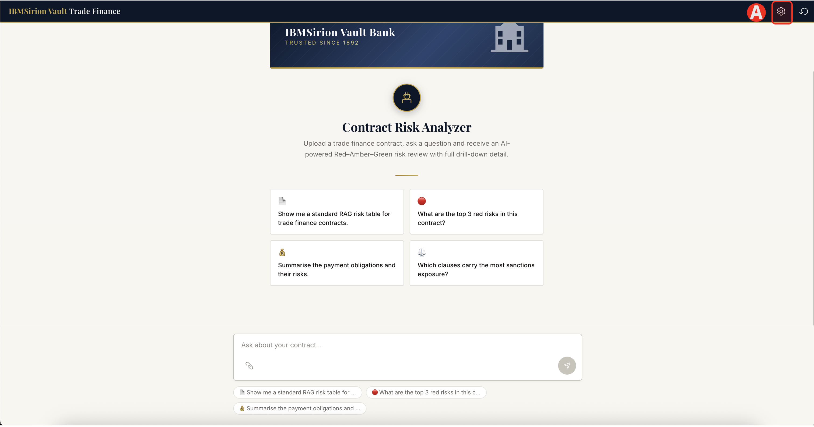
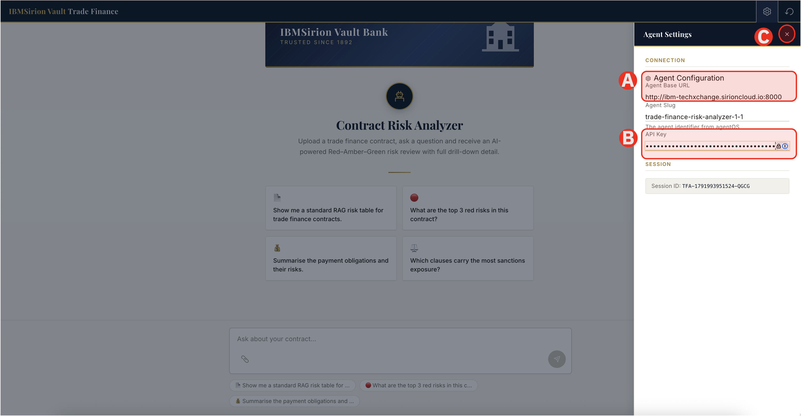
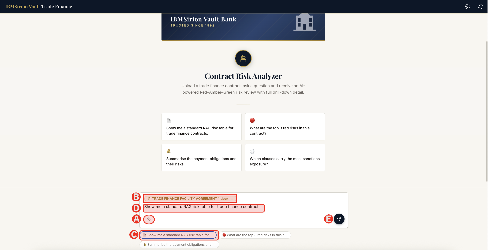
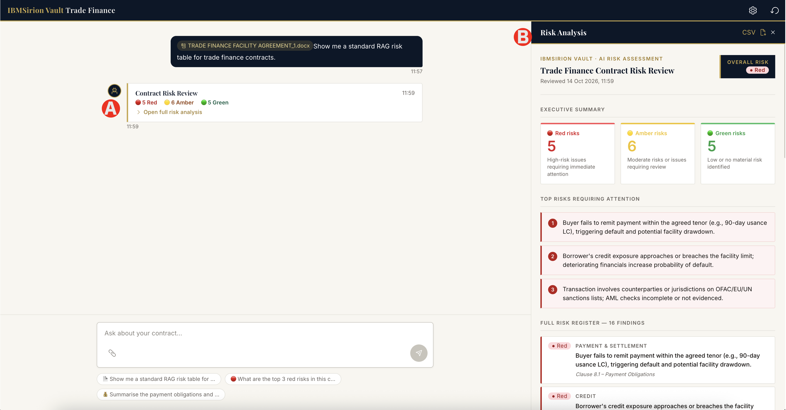

# 2.3 Test Agentic AI Application

After the Agentic AI application for Banking is deployed you should be able to test it. 

The backend of the application is integrated with Agent created in Sirion agentOS. In enterprise environment we can connect the Agentic application to 3rd Party Software Vendors like Sirion agentOS through a private endpoint keeping data residency within the private network boundry for security and compliance.

Before you start you need to make sure you have the following

- [x] Public Domain URL created in Serverless Project in previous step
- [x] Agent Slug created in Sirion agentOS
- [x] API Token created in Sirion agentOS (**Build Agents on Sirion agentOS > [Generate Agent API Key](lab1/05-api.md)**)

## Step - 1: Configure the Application

In your browser copy and paste Application Domain URL you just created. 

The Bank Application will Open. You will need to configure the settings to integrated with Sirion Agent

You will see the banking application being rendered

(A) Click on the settings to add the API Token created in Sirion agentOS

## Step - 2: Provide API Token

Configure the application with the API Token you created in Sirion agentOS platform

(A) Do not change the base URL. This is the base URL to Sirion agentOS platform

(B) Add the API Token that you have generated in Sirion agentOS platform

(C) Close the setting. (There is no save button. It gets automatically saved)

## Step - 3: Ask with User Prompts

Attach the "Trade Finance Agreement Document" to identify and analyze the RAG (Red, Amber, Green) risks with user prompt provided

(A) Attach the file by clicking the attach icon

> The file is provided in the pre-requisites. You can also download the file from here [TRADE FINANCE FACILITY AGREEMENT.docx](lab1/files/TRADE_FINANCE_FACILITY_AGREEMENT_1.docx ':ignore')

(B) You will see the file attached in the chat box

(C) Click on the user prompt "Show me a standard RAG risk table for trade finance contracts." for easy query

(D) The prompt will be added in the user chat box

(E) Click "Send" button

## Step - 4: Final Risk Analysis Result

The response may take some time from the Agent as it has to analyze the Agreement document and use knowledgebase to perform Risk Analysis Report

(A) The result is shown with Red as High Risk, Amber as Medium Risk and Green as Low or no risk.

(B) When you click the response you will see the nice deterministic UI you provided to the Agent while building in Sirion agentOS

(C) A full Executive Summary with all the risks findings are provided in the nice UI on left hand side bar

---

### Watch the walkthrough

<video controls width="100%">
  <source src="lab2/videos/2_3_test_app.mp4" type="video/mp4">
  Your browser does not support the video tag.
</video>

---

## ✅ Checkpoint

- [ ] You have created an end to end Enterprise Agentic AI Solution in IBM Cloud with Sirion agentOS
- [ ] A full scale industry use case is implemented to analyze the contract agreement risks

**You have successfully completed the Lab 2930".**

## 🎉🎉🎉 Congratulations! 🎉🎉🎉

